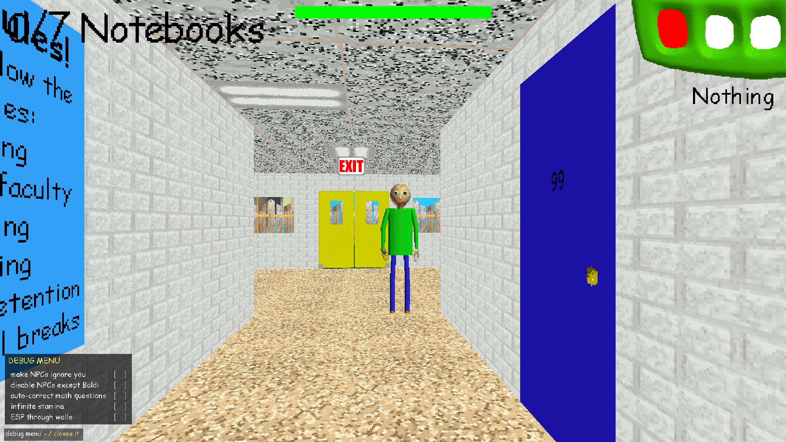
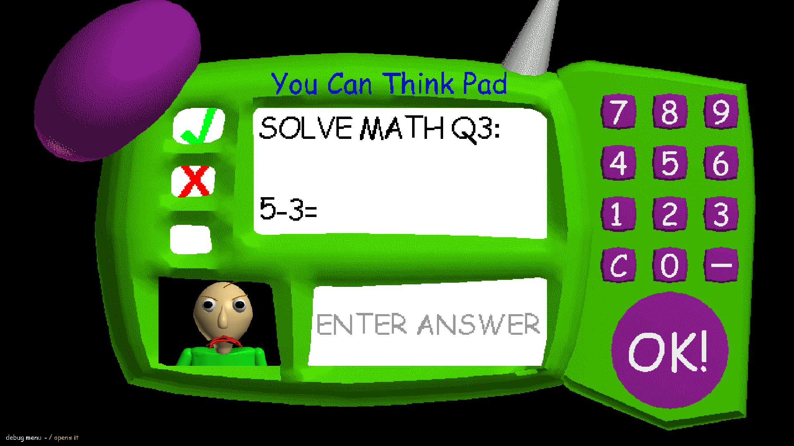
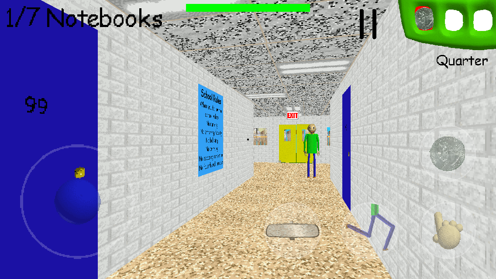

Baldi's Basics 1.4.3 ported to C++ making it easier to port it to more operating systems/platforms and removing the requirement of Unity. Made with the help of https://pspleaffox.itch.io/baldi-open-source-classic-party, GLM 5.3 flash and Opus 5.5 

Use the -debug parameter for a few cheats and debugging features

iOS port of this is also open sourced on here for iOS 6 and above, with a build guide

<table>
  <tr>
    <td></td>
    <td></td>
  </tr>
  <tr>
    <td colspan="2" align="center">
      
       
      
The game is running on iOS 6 in the third screenshot

    </td>
  </tr>
</table>

